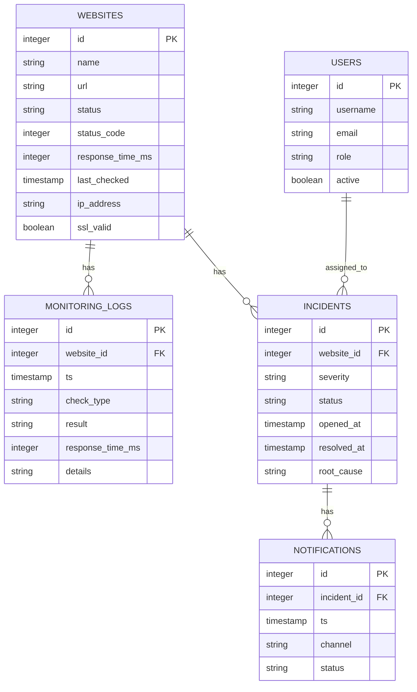

# Entity Relationship Diagram (ERD) - Monitoring DB

Catatan: struktur ini disesuaikan dengan tabel yang disebutkan di backend dan diagram lampiran; tambahkan kolom audit (created_at, updated_at) sesuai kebutuhan.